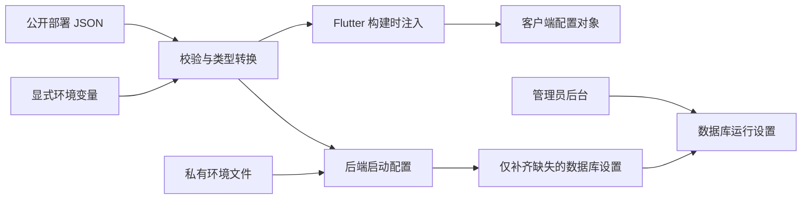

# 配置设计与使用

## 配置边界

部署环境、应用运行设置和业务常量分别管理：

| 类型 | 配置入口 | 生效时机 | 可以提交到仓库 |
| --- | --- | --- | --- |
| 公开部署参数 | `config/deployment.json`，或 `DUOYI_CONFIG_FILE` 指定的 JSON | 客户端重建；原生后端重启；Docker 镜像更新后重建容器 | 可以，禁止放密钥 |
| 工具链版本 | `config/toolchain.json` | 本地安装和 CI 构建 | 可以 |
| 后端私密与启动参数 | 进程环境；`backend/.env`，或 `DUOYI_ENV_FILE` 指定文件 | 原生后端重启；Compose 环境文件变更后重建容器 | 私密文件不提交，提交 `.env.example` |
| 管理员运行设置 | 管理员后台 / SQLite `settings` | 按现有接口即时生效 | 不提交数据库 |
| 用户偏好 | 现有 Provider 与云同步数据 | 保留现有行为 | 不提交用户数据 |
| 安装端服务器连接 | 登录页；本机持久化服务器地址和绑定到该服务器的凭据 | 验证令牌后即时生效 | 不提交凭据 |
| 协议、API 契约、产品标识与业务规则 | 对应代码模块 | 代码版本升级 | 保留在代码中 |



Python 公共配置模块 `backend/deployment_config.py` 没有数据库或应用启动副作用。Dart 的 `ClientDeploymentConfig` 负责客户端类型和校验，`AppConfig` 只读取构建时注入的参数。业务代码不再指定具体服务器域名或 Fork 更新仓库。

## 公开部署参数

本实例的 `config/deployment.json` 维护 `https://todo.skydrow.site` 和 `ioppe/duoyi`。其他实例可以复制 `config/deployment.example.json`，例如生成被 Git 忽略的 `config/staging.local.json`。

| 参数 | 含义 |
| --- | --- |
| `DUOYI_SERVER_URL` | 安装端初始后端地址，可在登录页修改；Web 默认始终使用当前站点同域后端 |
| `DUOYI_UPDATE_REPOSITORY` | APK 更新源 `owner/repository`；空字符串停用 GitHub 更新源 |
| `DUOYI_HTTP_TIMEOUT_SECONDS` | 一般请求超时，默认 12 秒 |
| `DUOYI_FILE_TIMEOUT_SECONDS` | 文件传输请求超时，默认 30 秒 |
| `DUOYI_AI_TIMEOUT_SECONDS` | AI 代理请求超时，默认 180 秒 |
| `DUOYI_UPDATE_TIMEOUT_SECONDS` | 更新检查超时，默认 8 秒 |
| `DUOYI_WEB_TARGET` | `responsive`、`desktop` 或 `mobile` |
| `DUOYI_WEB_BASE_HREF` | Web 部署路径，必须以 `/` 开始、结束 |
| `DUOYI_BACKEND_SERVICE` | systemd 服务或 Docker 容器名 |
| `DUOYI_BACKEND_RUNNER` | `systemd` 或 `docker`；只用于运维脚本 |
| `DUOYI_LOCAL_BASE` | 运维脚本检查本机后端的地址 |
| `DUOYI_WEB_ROOT` / `DUOYI_WEB_BACKUP_ROOT` | 网页部署和备份目录 |

JSON 文件拒绝未知键、重复键、密钥字段、无效 URL、非法更新仓库名、越界超时和危险根目录。密钥即使出现在进程环境中，也不会进入生成的客户端配置文件。

公开配置优先级为：**显式环境变量 > 指定的 JSON 文件 > 中立的 schema 默认值**。`DUOYI_CONFIG_FILE` 可以指定另一个文件；显式指定但文件不存在会报错。独立部署后端没有默认 JSON 文件时允许中立回退。

显式空值与未设置不同，例如 `DUOYI_SERVER_URL=` 会覆盖 JSON 中的服务器地址。没有注入任何部署参数的客户端不会自动连接作者或当前实例的服务器；原生端仍可离线使用。

## 安装端与 Web 登录

Android、iOS、Windows、Linux 及后续 macOS 客户端共用运行时连接逻辑。登录页默认输入服务器地址和访问令牌，也保留账号密码/邮箱登录入口。地址必须包含 `http://` 或 `https://`，可输入端口和部署前缀；不允许夹带账号密码、查询参数或片段。末尾 `/api/` 会自动归一化。

Web 无需填写服务器地址，登录页可选密码、邮箱验证码或访问令牌；令牌表单显示当前站点地址并禁止修改，所有方式默认请求当前 origin 的 `/api/*` 与 `/ws/*`。构建 profile 中的服务器值只作为安装端初始值，不会把 Web 的账号凭据发到另一个实例。独立托管的前端需在本 origin 反代 API 和 WebSocket。

1. 在服务器网页版使用账号密码登录。
2. 打开“我的 → 个人资料 → 访问令牌”，创建命名令牌，可选择无过期、30 天、90 天或一年。
3. 复制仅显示一次的完整令牌，在安装端填写服务器地址和令牌后登录。
4. 每台设备分别创建令牌。列表可查看最近使用时间、过期时间和当前设备，撤销立即失效；撤销当前令牌会退出本机登录。

令牌持久化在后端 SQLite 中，服务重启后仍有效，数据库只存令牌摘要。密码重置、更改密码、禁用或删除账号会撤销相应令牌。普通密码登录会话仍沿用现有生命周期。

客户端先验证新连接；验证失败保留当前连接。服务器和账号共同决定本地数据归属；成功切换前停止旧同步并清理旧账号缓存、凭据和同步基线，避免跨服务器上传。离线且尚未同步的内容应先备份，切换不是合并数据的操作。

## 语言与应用时区

界面语言默认跟随系统：系统语言为中文时显示简体中文，其他语言回退英文。用户可在“我的 → 个人设置 → 显示与行为 → 界面语言”或“扩展 → 语言”显式选择简体中文/English/跟随系统，选择持久化在本地（`duoyi_locale_v1`），切换后无需重启即刻生效；系统语言变化时，处于“跟随系统”状态的界面会同步更新。

应用时区同样默认跟随系统，也可固定为指定 IANA 时区（如 `Asia/Tokyo`、`America/New_York`、`UTC`）。该设置只影响应用内的壁钟语义，不修改设备系统时区：

- 跟随所选时区：今日页/日历的“今天”、日期分组、按天统计、习惯打卡周期、提醒触发时刻、黄历与日期格式化。
- 保持真实瞬时：同步时间戳、记录 `updatedAt`、计时器已流逝时长、番茄钟会话起点等。
- 只存年/月/日的浮动日期（如待办 `date`、纪念日）不因换时区而平移，仍按原年月日展示。

切换时区会立即刷新今日页、日历与统计，并排队重放提醒调度，使提醒的实际触发时刻对应用户设定的新壁钟时间。设备系统时区在后台发生变化时，处于“跟随系统”状态的应用会在恢复前台时重新解析并重放提醒。

## 本机偏好持久化

显示与行为、日期格式、周起始日、应用时区、默认入口、底部导航、触感和提醒选项属于本机配置，通过 `PreferencesProvider` 写入 `SharedPreferences`。关闭应用、重新启动、会话失效及普通账号数据清理均保留这些 `pref_*` 值；账号私有业务数据、历史、凭据和同步基线仍在退出或切换账号时清理。应用字体大小的换号边界见下文，外观购买、奖励与账号缓存继续遵循原有账号隔离规则。

“我的 → 个性设置 → 显示与行为 → 应用字体大小”打开独立字号页，默认标准（100%）。原生 Android 提供 55%、70%、85%、100%、115%、130%、145% 七档，100% 位于正中间，可向下缩小三档、向上增大三档；Web（含安卓浏览器）、iOS 和桌面保持 85% 至 190% 原八档。拖动只修改预览，点击“完成”后写入 `pref_text_scale` 并应用到全局，返回取消未保存调整。原生 Android 的标准 100% 默认正文为 10（系统未额外放大时），由 `DesignTokens.androidFontSizeBody` 和根部 `AppTypography` 提供 10/14 平台基准，标题、辅助文字、说明、按钮和导航文字按同一比例保留原层级。Web、iOS 和桌面继续使用共享字阶：正文 14、辅助 12、说明 11、页标题 18。平台基准、应用档位和系统缩放分开组合，保留系统线性/非线性策略；预览保留一次 Android 基准，只替换用户档位，避免重复缩放。Android 七档正文依次为 5.5、7、8.5、10、11.5、13、14.5。有效已存档位原样保留；旧版 160%、175%、190% 在 Android 读取时就近归到 145%，普通加载不改写磁盘，用户保存或账号绑定沿用既有写入规则，不执行强制默认档迁移。

当前平台有效的已保存字号在杀进程、重启、会话失效、退出后登录同一账号时保留。`pref_text_scale_owner_v1` 在本机记录规范化服务器身份与用户 ID；首次绑定账号接纳归一化后的既有字号，只有成功登录到另一个服务器/用户身份时才将字号恢复为标准（100%）。普通启动残留数据清理不能触发重置；字号和身份标记不加入云同步业务数据。日期、触感等其他本机偏好的换号行为保持原规则。
严格专注的分心应用选择保存在番茄钟本机配置 `pomodoro_config` 中。默认是黑名单模式，勾选的应用才会记录为分心应用；切换到白名单模式后，勾选的应用视为无关应用，其余扫描到的可启动应用会作为分心应用。Android 通过 Launcher 查询扫描应用名和包名，不申请 `QUERY_ALL_PACKAGES`；扫描失败时白名单拦截会暂停并提示，不会把空结果误当成“全部放行”。

开启云同步时，设置保存同时等待变更时间戳和待同步键落盘；较旧的远端偏好快照不能覆盖更新的本地配置。首页日历开关继续只在本机保存。

## Android 小组件同步与入口

Android 核心待办、习惯、月历、专注（含尺寸变体）及历史兼容综合小组件，只有底部四标签在组件内部切页；选中页按桌面实例及实际 Provider 保存。上方标题、logo、空白、统计、日期和专注操作入口打开当前内容对应的 App 分页；具体任务和习惯提示进入对应详情，不直接完成、打卡或启动专注。旧“打开 App”和“+ 添加”按钮保持收起；首次简洁样式保持精简，已切页实例保留四标签。

App 内 Provider 变化先进入串行推送队列，正常编辑防抖 2200ms；尚未完成本地数据加载的变更保留待推标记，等待加载完成后再读取完整快照。应用 inactive、hidden、paused 或 detached 时立即处理待推内容；失败保留待推状态，下次变化或恢复前台时重试。原生刷新返回 0 或失败时不缓存为成功，避免同一份数据被去重后无法补推。待办仍显示现有“今日任务”筛选下的 Top3，历史综合页默认展示聚合统计，需切至底栏“待办”查看任务标题。

原生更新在 `getAppWidgetInfo` 暂缺时，通过系统 `getAppWidgetIds` 的实例归属核验恢复真实宿主，保留各实例选中页和密度；不渲染无法确认归属的 ID。Android 启动图标、应用内小组件预览、9 个可见独立组件及历史综合组件左上角统一使用现有 Web `Icon-512.png` 的同源 logo；原生组件使用 128px 派生资源，旧文字标题仅保留隐藏 View 供兼容。

旧 `home_widget` 完成待办、打卡和开始专注请求仍兼容：先校验登录态与服务器/账号数据归属，主引擎存活时交给已有 Provider，冷后台先初始化应用时区再加载本地数据。动作后重算摘要并刷新 13 个可切页 Provider 宿主，保持重复操作及同步标记规则。升级后先打开应用一次完成注册；其他独立模块和 iOS 对象深链行为保持原契约。

## 添加到系统日历

Android 任务详情在设置截止日期后提供“添加到系统日历”，通过 `ACTION_INSERT` 打开设备日历的新建事项页面，预填任务名、备注、日期时间和应用时区。纯日期预填全天事项，具体时刻预填一小时事项；用户在系统日历点击保存后才完成创建，取消不会创建。多仪不申请日历读写权限、不保存事件 ID，也不负责事项后续修改、删除或同步；设备没有可处理该操作的日历应用时显示失败提示。

## 本地命令

在仓库根目录执行：

```bash
python3 scripts/project_config.py validate
python3 scripts/project_config.py get DUOYI_SERVER_URL
python3 scripts/flutter_with_config.py run
python3 scripts/flutter_with_config.py build apk --debug
python3 scripts/flutter_with_config.py build web --release
```

使用其他环境，或检查最终命令而不运行 Flutter：

```bash
python3 scripts/flutter_with_config.py --config config/staging.local.json build web --release
python3 scripts/flutter_with_config.py --dry-run build apk --release
```

Web 默认同源；需要移动布局时可显式覆盖布局：

```bash
python3 scripts/flutter_with_config.py build web --release \
  --dart-define=DUOYI_SERVER_URL= \
  --dart-define=DUOYI_WEB_TARGET=mobile
```

入口生成 `build/config/client-defines.json`，只导出允许进入客户端的公开键，然后使用 Flutter 的 `--dart-define-from-file`。后续显式 `--dart-define` 优先，已有手动构建方式仍可使用。直接调用 Flutter 时，应自己传入配置；仅设置 shell 环境变量不会让 Dart 自动读取它们。

本机可执行文件位置使用 `FLUTTER_BIN`、`PYTHON_BIN`、`ADB_BIN`、`ANDROID_SDK_ROOT` / `ANDROID_HOME` 等环境变量；未指定时从 SDK 路径或 PATH 查找，不绑定某位开发者的用户目录。

## 后端配置与兼容性

复制 `backend/.env.example` 为私有文件 `backend/.env`。只有没有任何既有表结构的新建/空 SQLite 数据库会自动创建 bootstrap 管理员，用户名默认为 `admin`，可由 `ADMIN_BOOTSTRAP_USER` 指定。`ADMIN_BOOTSTRAP_PASSWORD` 含非空白字符时沿用显式密码；留空、仅空白或未配置时，首次成功初始化使用系统安全随机源生成 256 位随机密码。环境文件只接受 `KEY=value`、成对的单/双引号、空值及独立注释行；不执行 shell、不插值、不支持 `export` 或行尾注释。

自动生成的用户名和初始密码仅写入数据库实际路径旁的 `<DUOYI_DB_PATH>.bootstrap-admin.json`，例如默认的 `backend/duoyi.db.bootstrap-admin.json`。文件以排他创建方式建立，权限为 `0600`（仅服务运行账号可读写）；已有文件或符号链接不会被覆盖。设置显式密码不会生成此文件。运维人员通过服务运行账号或 root 在服务器本地读取，例如自定义数据库为 `/srv/duoyi/duoyi.db` 时：

```bash
sudo cat /srv/duoyi/duoyi.db.bootstrap-admin.json
```

文件为含 `username`、`password` 的 JSON；用这组凭据在 Web 或应用的账号密码入口登录，随后修改密码，并妥善保管或删除初始凭据文件。此文件记录的是初始值，修改密码后不会更新，删除后也不会在重启时重建。容器部署需在容器内或其持久化数据库挂载目录中本地读取。不要将数据库目录或凭据文件放入 Web 静态目录、公开配置或仓库；初始密码不会通过日志、异常、`/api/bootstrap`、`/api/config` 等接口返回。

登录页不再显示固定的“首次使用 admin”提示；安装时由运维在本地获取上述初始凭据。Web 只有账号密码及已启用的邮箱验证码入口，访问令牌登录供安装客户端使用。

邮箱验证码登录默认关闭。管理员在“全站设置 → 账户、注册与用户组”开启“允许邮箱验证码登录”，并在邮件设置中启用账号邮件服务、配置有效的发送渠道后，登录页才显示此方式。`EMAIL_CODE_LOGIN_ENABLED=true` 只用于首次补齐缺失的设置键；后续数据库中的管理员设置优先。公开 `email_code_login_enabled` 返回开关与实际邮件配置共同决定的最终状态，不返回邮箱密钥。关闭开关或邮件服务后，登录用途的发码和验证码登录接口同样被禁用。

数据库初始化与首次创建在同一写事务内串行执行，并发启动仅一个进程创建管理员和凭据。所有数据库初始化步骤成功后才写入并同步凭据文件；写入或提交失败会回滚数据库并清理本次创建的文件。若进程恰在文件创建后、数据库提交前被强制终止，可能留下完整或部分凭据文件；下次启动会拒绝覆盖它。此时先确认数据库确为未初始化的新库，再由运维保管并移走遗留文件后重试，切勿删除现有实例的数据库。

后端优先级为：**进程环境 > 私有环境文件 > 公开 JSON 派生默认 > schema 默认**。历史 SMTP、邮件与 OpenClaw 变量别名仍可用，同一来源中的别名顺序保持兼容。高优先级来源中的旧别名仍高于低优先级来源中的新键名。

- Web 默认同源；独立前端需要把 `/api/*`、`/ws/*` 代理到目标后端。CORS 允许列表仍供受支持的集成使用，不能替代代理。
- `DUOYI_DB_PATH`、上传目录、备份目录、CORS、在线状态时长、轮询间隔等由 `BackendSettings` 类型化读取。
- `CORS_ORIGINS` 未单独提供时，由公开后端地址派生；空值表示不开放跨域。相同域名和 Android 原生请求不依赖额外跨域许可。
- 密码、API Key、SMTP 密码和 WebDAV 密码只能放在后端环境或受权限保护的管理员设置中，不能写入公共 JSON 或 Dart define。
- AI、注册策略、邮件与备份的环境参数只补齐数据库中缺失的键；已有管理员配置不会因重启或修改默认值被覆盖。
- `REGISTRATION_EMAIL_REQUIRED` 默认 false，新库允许用户名和密码注册。环境值只补齐缺失键；保留数据库中已有的 true/false 策略，不再运行旧的强制开启邮箱验证迁移。注册未提供昵称时使用用户名，之后可修改个人资料中的昵称。
- 既有数据库不再创建 bootstrap 账号，即使 bootstrap 用户名不存在、已改名、已删除或数据库中的用户已清空也一样；不会重置密码或把同名普通用户提升为管理员。更改 bootstrap 环境变量不会为既有安装新增管理员。公开注册始终创建普通用户。
- **必须保留已有 `PASSWORD_HASH_SALT`。** 未设置时沿用旧算法兼容常量；已有实例若配置了自定义 salt，需要原样保留，改盐会使原密码无法校验。
- 客户端版本优先从根目录 `pubspec.yaml` 读取；只有独立后端没有版本文件时，才回退到 `0.0.0/0`。API 契约版本仍由代码定义。

配置校验错误只指出字段名和要求，不回显密码、Key 或原始配置内容。配置对象隐藏私密字段的字符串表示。

## AI 网关响应与错误诊断

AI 请求统一经后端 `/api/ai/chat` 发往配置的 OpenAI 兼容 `chat/completions` 地址，并显式发送 `stream: false`。如果网关仍返回 SSE，后端会聚合 OpenAI `choices[].delta.content` 或 Anthropic `content_block_delta` 的文本，再给客户端返回普通 JSON；也兼容 Anthropic Messages 形状的 JSON 响应。thinking/reasoning 不作为报告正文。

网关的 HTTP 200 只表示该段请求有响应，不能代替完整的报告正文。后端分别报告网络连接失败、响应格式错误、流中错误和空正文；周报与管理后台测试保留具体错误详情，不把所有 502 都解释成“上游不可达”。空正文可根据 `finish_reason` 和实际 reasoning token 用量诊断，避免把正常 `stop` 的响应一概当成输出预算不足。管理员测试与周报共用解析逻辑，只有真实返回非空正文才判定成功。

`minimax-m3.1-flash-free` 的内容生成请求预留至少 8192 个输出 token，覆盖共享预算的推理与正文；256-token 连通性测试保持短请求。长报告的后端上游等待上限为 150 秒，客户端默认等待 180 秒，仍可通过公开配置覆盖客户端值。部分网关不单列 reasoning token 数，此时结合 `finish_reason=length` 与 `reasoning_content` 是否存在判断空正文截断；超时单独返回 504，不再归类为网络不可达。

## CI 与运维脚本

CI 的 `configuration` job 先校验部署 profile 和 `config/toolchain.json`，后续测试、Android 和 Web job 共用这一份公开参数。仓库 Variables 可覆盖 `DUOYI_SERVER_URL`、`DUOYI_UPDATE_REPOSITORY`、`DUOYI_WEB_BASE_HREF`；手动运行的 `same_origin` 可显式选择空地址。

自托管 Web 包按部署 profile 的 base href 构建。GitHub Pages 另外生成自己的 `build/web-pages`，默认路径来自当前仓库名，也可通过 `DUOYI_PAGES_BASE_HREF` 设置。根路径产物不会再被直接用于 Pages 项目子路径。

正式签名 Secrets 保持不变，缺失时构建失败，不回退到调试签名。工具链版本统一由 `config/toolchain.json` 提供。

仅检查部署目标，不重启或覆盖服务：

```bash
bash scripts/deploy_backend_prod.sh --check-config
bash scripts/deploy_web_prod.sh --check-config
```

实际执行部署脚本会重启后端或替换网页，应在完成构建、备份和发布准备后调用。Docker 模式的 `restart` 只重启原容器，不构建镜像、不替换镜像，也不重新读取 Compose 的 `env_file`。发布新后端时，需要先构建镜像，再用 `docker compose up -d --force-recreate backend` 等现有发布步骤重建容器；配置模块、公开 profile 与版本元数据也必须随新版本一起打包。

## 从旧配置迁移

1. 把客户端原先写在 `AppConfig` 和 `main.dart` 中的域名、更新源迁入公开 JSON。
2. 将现有服务器环境变量保留在部署工具或私有环境文件中，特别是数据库路径、bootstrap 身份和原密码 salt。
3. 保留 SQLite 数据库；已有数据库设置优先于新的默认值，不需要重新初始化。
4. 新后端需要携带全部运行时 Python 模块（包括令牌存储模块）、公开 profile 与版本元数据；客户端通过新入口重新构建。
5. 在测试环境核对登录、同步和更新源后，再更新线上实例。

本次配置重构本身不会自动修改已经部署的服务或数据库，也不会提交真实密钥到仓库。
