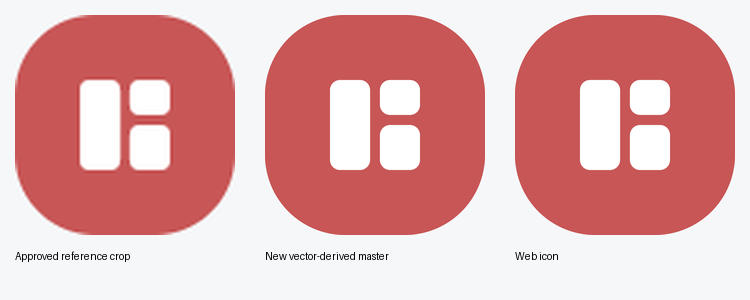
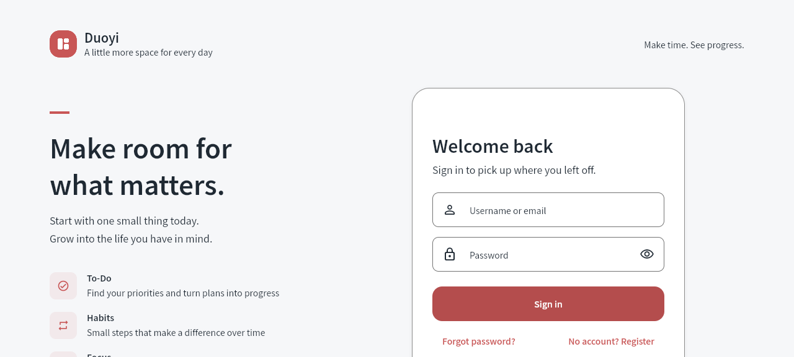

# 指定 Logo 与更新配置保留约定

本次依据用户提供的原始图，纠正了平台资源虽然一致、实际却指向旧日历图样的问题。批准的设计为红色 `#C85656` 圆角方块与白色三块几何标志，规范见 [应用 Logo 约定](../../../docs/branding.md)。

原图包含 ICC 色彩配置。转换到 sRGB 后确认品牌红 `#C85656`、白色 `#FFFFFF` 与衬底 `#F6F7F9`；原始文件逐字节保存在 `assets/logo/duoyi_logo_reference.png`。上图中的参考区域已裁去截图页面边距。矢量母版生成图缩回原标志 88×88 后，每通道平均绝对像素差低于 1.2/255；对照图已在浏览器中目视检查。

## 本次检查

| 检查 | 结果 |
| --- | --- |
| `python3 scripts/sync_app_icons.py --check` | 退出 0；46 个文件与统一来源匹配 |
| `test/services/platform_logo_assets_test.dart` | 6 项通过；含原图身份色/白块/间距、平台来源、透明前景及尺寸 |
| `test/screens/auth_registration_layout_test.dart` | 19 项通过 |
| `test/services/rounded_typography_static_test.dart` | 4 项通过 |
| 全项目 `dart analyze --fatal-infos` | 退出 0，0 问题 |
| `dart format --output=none --set-exit-if-changed` | 退出 0；2 个文件，0 改动 |
| `git diff --check` | 退出 0 |
| 测试前后源码/母版哈希 | 7 个文件一致 |
| 应用身份、版本与配置存储实现 | 14 个文件哈希未变；版本仍为 `1.1.47+140013` |

三套相关 Flutter 测试合计 29 项。未重跑与本次 Logo 修改无关的后端/偏好套件。原图、SVG、canonical PNG 的校验值见 [validation.json](validation.json)。

## 已固化的维护约定

- `AGENTS.md`、`CLAUDE.md`、`docs/design-v2.md`：所有平台固定使用批准图样；更新应用保留用户配置及既有应用身份。
- `docs/branding.md`：原始参考、母版、平台映射、色彩、生成与校验命令、旧图样历史状态。
- `docs/configuration-persistence.md`：Android/iOS/macOS/Linux/Web 的存储机制、覆盖更新条件，以及清数据/换身份/账号清理/恢复备份的边界。
- `docs/manual-regression-checklist.md`：实际覆盖安装与各平台 Logo 显示的待执行检查。

## 资源修订阶段的验证边界

资源修订阶段交付了项目资源、认证页展示、生成/校验工具和开发文档，没有更改应用 ID、签名、沙盒、Web origin、配置存储键或版本；当时没有执行服务器部署或新的正式 Release。后续按用户要求单独发布 Web，记录如下。

本次没有进行 Android、iOS、macOS、Linux 的实际覆盖安装，也没有安装新的原生包或 PWA。现有安装包需后续覆盖更新才能使用新资源；iOS 资源存在不等于完成签名发布。配置保留结论依据实际存储与更新代码审计，并承接此前已完成的共享 Provider 回归及 Web 两次刷新证据，不能据此宣称所有平台升级已实测。

## 后续 Web 发布

源码提交 `5ebb9b207d7ae6ef814978bc488d37eb595edd04` 已构建并部署到 `https://todo.skydrow.site`，版本仍为 `1.1.47+140013`。详见 [部署验证记录](web-deployment.json)。

- 新 release 为 `v1.1.47-5ebb9b2-approved-logo`，120 个文件上传后全部哈希匹配，再原子切换静态链接。公网 12 个关键文件（JS、启动脚本、字体策略、新 Logo、favicon 和 PWA 图标）与本次构建一致。
- 旧 release `v1.1.47-persistence-dccb2c8` 的 116 个文件完整保留，备份记录位于服务器 `/opt/duoyi/web-backups/approved-logo-20261101T054957Z-5ebb9b2`，目录权限 700、状态文件 600。
- 后端镜像与启动时间未变、健康检查通过；原 `.env`、数据挂载及数据库不由本次静态部署修改。继续使用原域名与 origin，不清理用户浏览器配置。
- 全新匿名浏览器自然加载了指定红底白色 Logo，资源摘要匹配，登录页控件可用；无表单提交或真实账号登录，未观察到页面/控制台错误。测试会话已关闭。
- 首帧时子集字体 1 次、完整字体 0 次；完整字体在首帧后 15.003 秒开始，最终 1 次加载成功。此为单次测量，非启动耗时保证。

若旧标签页仍显示缓存内容，强制刷新获取新构建即可，不需要清除站点数据。本次只发布 Web，未安装新的原生客户端或 PWA。
