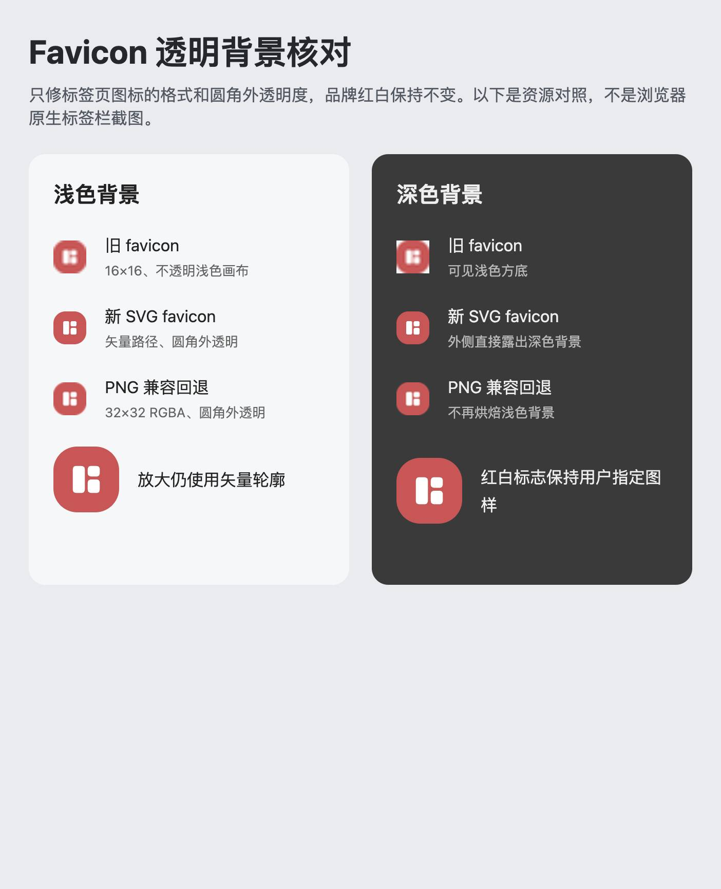

# 浏览器 favicon 矢量与透明背景修复

## 原因与修复

原网页只声明 16×16 RGB PNG favicon，并沿用原生打包图的 `#F6F7F9` 不透明画布。因此在高像素密度屏幕上不够清晰，深色标签页还会露出浅色方底。

现在优先使用 `web/favicon.svg`（`image/svg+xml`、`sizes="any"`）；它由同一批准母版去掉最外层画布派生，只保留红色圆角块与白色矢量路径。32×32 RGBA PNG 作为兼容回退，四角透明，回退 URL 加格式修订标识避免旧缓存。SVG 声明在 PNG 后，支持 SVG favicon 的浏览器可采用矢量资源。

Logo 红白固定，不因浏览器主题变色。透明外侧露出标签页自己的底色；网页不能强制控制所有桌面浏览器的标签栏颜色，`theme-color` 与 PWA 启动背景是不同机制，本次不改它们。

此图为浏览器渲染的资源对照页，不是浏览器原生标签栏截图。深色区域可以复现旧图的浅色方框，新资源不再包含该底色。

## 检查结果

- `python3 scripts/sync_app_icons.py --check`：退出 0，47 个文件匹配，含新增 SVG 与透明 PNG。
- 两个相关 Flutter suite：8/8 通过、0 失败、0 跳过；包括 favicon 同源矢量结构、HTML 声明顺序、PNG alpha/颜色/白块及既有平台资源约束。
- 全项目 `dart analyze --fatal-infos`：退出 0，0 问题。
- 测试文件只读格式检查与 `git diff --check`：退出 0。
- Web release 构建一次成功；SVG/PNG 与项目源资源字节一致，版本保持 `1.1.47+140013`，启动字体子集与完整字库延迟资源及 OFL 均保留。
- 原生、PWA 安装图标、母版、参考图、应用版本及所检查存储实现共 55 个文件的哈希未变。

详细结果见 [validation.json](validation.json)。开发约定见 [branding.md](../../../docs/branding.md)。本阶段记录本地实现与资源核验；公网发布结果另行记录，不把原生安装图标更新或浏览器原生标签栏 UI 验收混入本结论。

## 公网发布与浏览器验收

已将源码提交 `4b0cf45f8abd2c9cb03542ff3bb55d32fade3c97` 对应的同一构建发布到 `https://todo.skydrow.site`；提交后逐字节核对了 286 个构建输入，再绑定产物来源。新 release 为 `v1.1.47-4b0cf45-favicon-svg`，120 个运行时文件全部哈希匹配后原子切换，旧 release 与回滚记录完整保留。详见 [deployment.json](deployment.json)。

第一次上传后，清单检查在切换前拦住了多出的 32 字节 Flutter 缓存标记 `.last_build_id`。确认所有清单文件均匹配后，仅排除该非运行时标记，再次校验并成功发布；没有修改已验收的运行时清单或放宽哈希校验。

- 公网 SVG 返回 `image/svg+xml`，与 PNG 回退、新页面声明和其他关键产物一致；SVG 保留 `sizes="any"`，PNG 为带修订 URL 的 32px 回退。
- 全新匿名浏览器从公网获取 SVG/PNG，MIME 与摘要匹配，解码后四角 alpha 全为 0；在 `#F6F7F9` 与 `#3A3A3A` 上合成，两种格式的四角像素都精确等于背景，红色色样均为 `(200,86,86)`。
- 这证明了公开资源的矢量结构、透明度和真实浏览器合成表现，不声称截取了 Chromium 原生标签栏。测试没有登录、填表或清理 localStorage，独立会话已关闭。
- 后端镜像和启动时间未变，仍健康；`.env` 保持原值，数据库未由本次静态发布修改，Web origin 不变。

旧标签页若仍显示缓存的图标，可关闭后重新打开，或强制刷新；无需清除站点数据。
